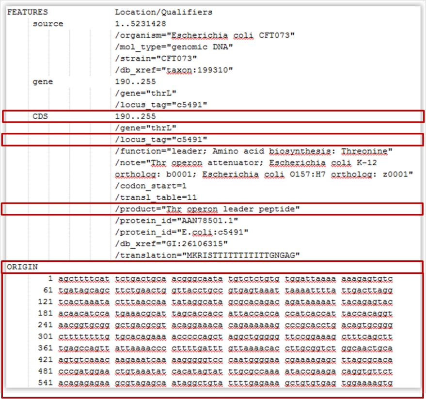
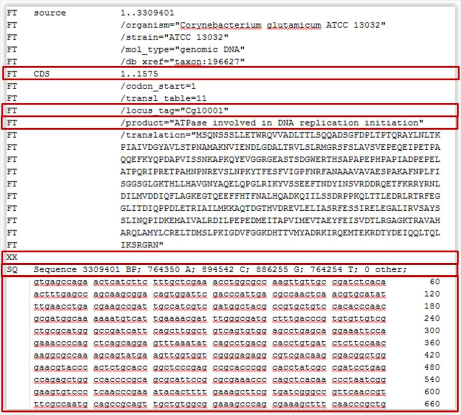
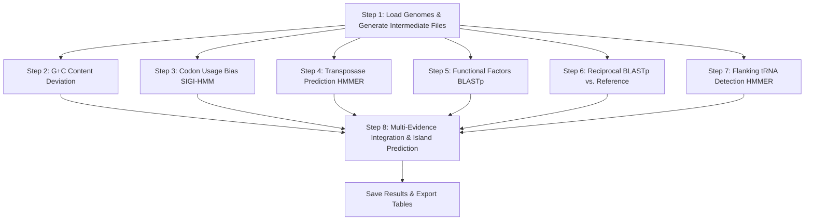

<p align="center">
  
</p>

# GIPSy — Genomic Island Prediction Software

### Offline Edition (Windows)

**GIPSy** is a computational software tool designed for the accurate *in silico* prediction and classification of bacterial **genomic islands (GEIs)** into functional subclasses:

- 🦠 **Pathogenicity Islands (PAIs)** — Virulence factors, toxins, and specialized secretion systems (T3SS, T4SS, T6SS).
- 💊 **Resistance Islands (RIs)** — Antimicrobial resistance genes, multidrug efflux pumps, and heavy-metal resistance.
- 🧬 **Metabolic Islands (MIs)** — Secondary metabolic pathways, iron-uptake siderophores, and novel catabolic operons.
- 🤝 **Symbiotic Islands (SIs)** — Symbiosis determinants, nodulation factors (*nod*), and nitrogen-fixation complexes (*nif*).

---

> [!WARNING]
> ### ⚠️ Linux Support Notice
>
> **Linux support has been officially deprecated** in this edition. Third-party Linux binary dependencies (legacy 32-bit HMMER and BLAST builds) are incompatible with modern 64-bit Linux distributions and are no longer maintained. GIPSy is now officially maintained and supported exclusively for **Windows (64-bit)** environments.

---

## 📑 Table of Contents

- [Overview &amp; Biological Relevance](#-overview--biological-relevance)
- [How GIPSy Works: Multi-Evidence Approach](#-how-gipsy-works-multi-evidence-approach)
- [Input File Formatting: Complete vs. Draft Genomes](#-input-file-formatting-complete-vs-draft-genomes)
  - [The Critical Importance of Complete Genomes (Why Drafts Fail)](#the-critical-importance-of-complete-genomes-why-drafts-fail)
  - [GenBank Format Requirements (.gbk, .gbff)](#genbank-format-requirements-gbk-gbff)
  - [EMBL Format Requirements (.embl)](#embl-format-requirements-embl)
- [System Requirements](#-system-requirements)
- [Repository Structure](#-repository-structure)
- [Installation Guide](#-installation-guide)
  - [Method 1: Offline Graphical Installer (Recommended)](#method-1-offline-graphical-installer-recommended)
  - [Method 2: Manual Setup (Without Installer)](#method-2-manual-setup-without-installer)
- [How to Launch GIPSy](#-how-to-launch-gipsy)
- [Detailed Step-by-Step Usage Guide (Steps 1 to 8)](#-detailed-step-by-step-usage-guide-steps-1-to-8)
- [Saving and Exporting Results](#-saving-and-exporting-results)
- [Troubleshooting &amp; Common Issues](#-troubleshooting--common-issues)
- [Citation, Developers &amp; Maintenance](#-citation-developers--maintenance)

---

## 🔬 Overview & Biological Relevance

Bacteria exhibit remarkable adaptability to diverse clinical environments, antibiotic selective pressures, and host immune defenses. Much of this evolutionary plasticity is driven by **Horizontal Gene Transfer (HGT)**, whereby large segments of DNA (typically 10 to >100 kb), termed **Genomic Islands (GEIs)**, are transferred between distinct bacterial lineages.

Accurately mapping GEIs is critical for:

- Characterizing the pathogenic potential of emerging clinical isolates.
- Tracking the dissemination of multidrug resistance clusters.
- Understanding bacterial speciation and niche adaptation.

GIPSy performs an integrative, comparative genomic analysis between a **Query genome** (the target strain under investigation) and a closely related, non-pathogenic **Subject/Reference genome** to identify, delineate, and categorize these genomic islands.

---

## ⚙️ How GIPSy Works: Multi-Evidence Approach

Rather than relying on a single metric, GIPSy applies a multi-criteria approach based on five hallmark signatures of horizontal gene acquisition:

1. **Atypical Base Composition (G+C Content)**: Foreign DNA introduced from distant donors often reflects the nucleotide composition of the donor, differing significantly from the host chromosome average.
2. **Codon Usage Deviation**: Synonymous codon choice is evolutionary conserved within a species. GIPSy uses the **Colombo / SIGI-HMM** algorithm (Hidden Markov Models) to detect anomalous codon frequencies.
3. **Mobility Machinery (Transposases & Integrases)**: GEIs frequently encode enzymes responsible for excision and integration. GIPSy uses **HMMER** profile models to identify transposase and insertion sequence (IS) domains.
4. **Flanking tRNA Integration Hotspots**: Most mobile islands integrate site-specifically into the conserved 3' terminal sequence of **tRNA or tmRNA genes**. GIPSy searches for flanking tRNA loci using HMMER.
5. **Absence in Non-Pathogenic Relatives**: Core bacterial genes are shared among closely related taxa, while island genes are lineage-specific. GIPSy executes **reciprocal BLASTp** between query and reference proteins to confirm island absence in the non-pathogenic relative.

---

## 🧬 Input File Formatting: Complete vs. Draft Genomes

### The Critical Importance of Complete Genomes (Why Drafts Fail)

> [!CAUTION]
> ### 🛑 DO NOT USE DRAFT GENOMES (CONTIGS / SCAFFOLDS)
>
> GIPSy **requires complete, fully assembled, and circularized bacterial chromosomes**.
>
> **Why draft genomes produce erroneous results:**
>
> - When draft genomes composed of tens or hundreds of contigs/scaffolds are submitted, the artificial break-points at contig ends disrupt gene synteny, create anomalous nucleotide borders, and break reciprocal BLAST alignments.
> - As a result, the sliding-window and HMM algorithms will falsely identify the ends of contigs as "genomic islands".
> - These are **assembly artifacts**, not biological horizontal transfer events.
> - Always use complete, closed genome sequences (e.g., NCBI `Complete Genome` status).

---

### GenBank Format Requirements (`.gbk`, `.gb`, `.gbff`)

Your GenBank files must be properly annotated with coordinate locations and translated protein sequences.

Key requirements (highlighted below):

1. **`LOCUS` line**: Contains the molecule name and sequence length.
2. **`FEATURES` header**: Must include:
   - `source`: with genomic span (e.g., `1..4641652`).
   - `CDS`: for each protein-coding gene, containing:
     - `/locus_tag="NAME"`: Unique identifier for the gene.
     - `/translation="M..."`: The full translated amino acid sequence.
3. **`ORIGIN` section**: Contains the complete nucleotide genomic sequence.


*Figure: Required GenBank (.gbk) formatting with essential tags highlighted in red boxes.*

---

### EMBL Format Requirements (`.embl`)

If using EMBL format:

1. **`ID` line**: Sequence identification and length.
2. **`FT` (Feature Table)**:
   - `FT   CDS             start..end`
   - `FT                   /locus_tag="NAME"`
   - `FT                   /translation="M..."`
3. **`SQ` section**: Complete nucleotide sequence.


*Figure: Required EMBL (.embl) formatting with essential tags highlighted in red boxes.*

---

## 💻 System Requirements

- **Operating System**: Windows 7, 8, 10, or 11 (64-bit).
- **Java**: **Java 8 (JRE 1.8)**.
  - Check your version in CMD/PowerShell: `java -version`.
  - If you have newer Java runtimes (Java 11, 17, 21), always launch the application using `run_gipsy.bat`, which binds directly to the Java 8 runtime.
- **Hardware**: Minimum 4 GB RAM (8 GB recommended for reciprocal BLAST of large genomes).
- **File System Rule**: **NO SPACES IN PATHS OR FILE NAMES** (see [Troubleshooting](#-troubleshooting--common-issues)).

---

## 📦 Repository Structure

Keep all repository files together in the same directory:

```text
📁 GIPSy/
├── 📄 GIPSy.Installer.jar   # Offline graphical installer (Windows)
├── 📄 GIPSy.jar             # Main GIPSy application
├── 📦 DB.zip                # Curated databases (virulence, resistance, metabolic, tRNA, transposases)
├── 📦 Dependencies.zip      # Windows binaries (BLAST 2.2.26, Colombo 3.8/SIGI-HMM, HMMER 3.0)
├── ⚙️ run_gipsy.bat         # Launcher script (ensures Java 8 and directory path)
├── ⚙️ config.properties     # Path configuration template
├── 📁 docs/images/          # Visual documentation and formatting diagrams
└── 📘 README.md             # This documentation
```

---

## 🚀 Installation Guide

> [!NOTE]
> The original installer from `bioinformatics.org` attempted to download files over HTTP from links that are now permanently offline (HTTP 404). This updated edition is **completely self-contained and operates 100% offline**.

### Method 1: Offline Graphical Installer (Recommended)

1. **Download/Clone** the repository to your computer.
2. Ensure that `GIPSy.Installer.jar`, `GIPSy.jar`, `DB.zip`, and `Dependencies.zip` are all present in the **same folder**.
3. **Double-click `GIPSy.Installer.jar`** (or open CMD and run: `java -jar GIPSy.Installer.jar`).
4. Select the target installation directory:
   - By default, GIPSy proposes `C:\Users\<user>\GIPSy`.
   - **Important**: Make sure the selected path has **no spaces**.
5. Click **Install**.
   - The installer automatically extracts `DB.zip` and `Dependencies.zip`, transfers `GIPSy.jar` and `run_gipsy.bat`, and configures the environment paths in:
     `C:\Users\<user>\AppData\Roaming\GIPSy\config.properties`
6. When the progress bar shows **"DONE! Enjoy GIPSy!"**, close the installer.

---

### Method 2: Manual Setup (Without Installer)

If you prefer to configure GIPSy manually without running the GUI installer:

1. **Create the target folder**: e.g., `C:\Users\<user>\GIPSy`
2. **Extract zip files**:
   - Extract `DB.zip` inside `C:\Users\<user>\GIPSy\` (creating `C:\Users\<user>\GIPSy\DB\`).
   - Extract `Dependencies.zip` inside `C:\Users\<user>\GIPSy\` (creating `C:\Users\<user>\GIPSy\Dependencies\`).
   - Copy `GIPSy.jar` and `run_gipsy.bat` into `C:\Users\<user>\GIPSy\`.
3. **Configure `config.properties`**:
   - Create the directory: `C:\Users\<user>\AppData\Roaming\GIPSy\`
   - Create a text file named `config.properties` containing (replace `<user>` with your Windows username):
     ```properties
     #Cp1252
     BlastExecutable=C\:\\Users\\<user>\\GIPSy\\Dependencies\\blast\\bin\\blastall.exe
     ColomboExecutable=C\:\\Users\\<user>\\GIPSy\\Dependencies\\Colombo_3.8\\okSigiHMM.class
     FormatDBExecutable=C\:\\Users\\<user>\\GIPSy\\Dependencies\\blast\\bin\\formatdb.exe
     HmmerExecutable=C\:\\Users\\<user>\\GIPSy\\Dependencies\\hmmer\\hmmsearch.exe
     WorkingFolder=C\:\\Users\\<user>\\GIPSy
     ```
   - Also place an identical copy of `config.properties` directly inside `C:\Users\<user>\GIPSy\config.properties`.

---

## ▶️ How to Launch GIPSy

Always start GIPSy through one of these methods:

1. **Using the Launcher (Best Practice)**:
   Double-click [run_gipsy.bat](file:///c:/Users/andre/Documents/UFTM/Projetos/Programas/GIPSy/run_gipsy.bat).
   - This ensures the working directory is resolved correctly (`cd /d "%~dp0"`) and invokes the installed Java 8 JRE.
2. **Direct JAR Execution**:
   Double-click `GIPSy.jar` (requires `.jar` files to be associated with Java 8 `javaw.exe`).

---

## 📖 Detailed Step-by-Step Usage Guide (Steps 1 to 8)

GIPSy organizes its computational pipeline across 8 sequential tabs:



---

### Step 1 — Input Genomes & File Pre-processing

- **Goal**: Ingest the query and reference genomes and generate the derived intermediate files used by each downstream algorithm.
- **Workflow**:
  1. Click **Open Query** and select the `.gbk` file of your target strain (e.g., pathogenic organism).
  2. Click **Create files** below the Query path.
  3. Click **Open Subject** and select the `.gbk` file of your reference strain (e.g., closely related non-pathogenic organism).
  4. Click **Create files** below the Subject path.
- **What happens under the hood**: GIPSy parses the GenBank files and populates `<WorkingFolder>/temp_files/` with translated FASTA proteins (`.faa`), whole-chromosome nucleotide sequences (`.fna`), coding sequences (`.ffn`), reformatted EMBL records (`.embl`), and coordinate tables (`.gff`).
- **Dependencies**: None. *All subsequent steps depend strictly on Step 1 completing successfully.*

---

### Step 2 — Anomalous G+C Content Analysis

- **Goal**: Identify regions whose guanine-cytosine ratio deviates significantly from the host chromosome baseline.
- **Workflow**:
  1. Specify the Standard Deviation cutoff (default: **`1.5` SD**).
  2. Click **Run** for both Query and Subject.
  3. Click **Visualize** to review the base composition curve across the genome.
- **Scientific Rationale**: Horizontally transferred segments commonly preserve the distinct G+C signature of their donor organisms. Increasing the SD threshold makes island identification more stringent.

---

### Step 3 — Codon Usage Bias (Colombo / SIGI-HMM)

- **Goal**: Detect clusters of genes displaying foreign synonymous codon usage patterns.
- **Workflow**:
  1. Set the sensitivity cutoff (range `0.5` to `0.95`, default: **`0.95`**).
  2. Click **Run** for both Query and Subject.
  3. Click **Visualize** to view genes classified as native versus putative alien transfers.
- **Scientific Rationale**: Colombo's SIGI-HMM employs an inhomogeneous Hidden Markov Model based on codon transition frequencies, identifying genes that did not co-evolve with the core host genome.

---

### Step 4 — Transposase Prediction (HMMER)

- **Goal**: Identify mobility genes (transposases, integrases, and IS elements).
- **Workflow**:
  1. Set the E-value threshold (default: **`0.0001`** / `1e-4`).
  2. Click **Run** and **Visualize**.
- **Scientific Rationale**: Profile Hidden Markov Models (`transposase.hmm`) identify insertion-mediating enzymes responsible for the horizontal mobilization and chromosomal integration of islands.

---

### Step 5 — Specific Functional Factors (BLASTp)

- **Goal**: Functionally classify the island by querying all translated query proteins against curated databases.
- **Workflow**:
  1. Set the BLASTp E-value cutoff (default: **`0.000001`** / `1e-6`).
  2. Select the factor type that matches your research objective:
     - **Virulence Factors** ➔ Predicts *Pathogenicity Islands (PAIs)*.
     - **Antibiotic Resistance** ➔ Predicts *Resistance Islands (RIs)*.
     - **Metabolic Factors** ➔ Predicts *Metabolic Islands (MIs)*.
     - **Symbiosis Factors** ➔ Predicts *Symbiotic Islands (SIs)*.
  3. Click **Run** and **Visualize**.
- **Interactive Inspection Features**:
  - **Click Column 1** of any row: Displays the complete **amino acid composition** chart for that gene.
  - **Click Column 2** of any row: Displays the raw **pairwise BLASTp alignment** against the reference database hit.

---

### Step 6 — Reciprocal BLAST (Query vs. Subject)

- **Goal**: Verify which query genes are absent in the closely related non-pathogenic reference genome.
- **Workflow**:
  1. Set the E-value cutoff (default: **`0.000001`** / `1e-6`).
  2. Click **Run** and **Visualize**.
- **Scientific Rationale**: GIPSy performs bidirectional BLASTp between all Query CDSs and Subject CDSs. Genes unique to the Query (absence of reciprocal orthologs) represent lineage-specific acquisitions.

---

### Step 7 — Flanking tRNA Gene Prediction (HMMER)

- **Goal**: Identify tRNA and tmRNA integration hotspots.
- **Workflow**:
  1. Set the E-value cutoff (default: **`0.0001`** / `1e-4`).
  2. Click **Run** and **Visualize**.
- **Scientific Rationale**: Phage-related integrases frequently target the conserved loops of tRNA genes. Proximity to a tRNA locus provides strong evidence for an authentic genomic island boundary.

---

### Step 8 — Multi-Evidence Integration & Island Prediction

- **Goal**: Synthesize evidence from Steps 1–7 to delineate and output definitive genomic islands.
- **Workflow**:
  1. Confirm that Steps 1 through 7 have all been executed.
  2. Select the desired island class (e.g., **Pathogenicity Islands**).
  3. Click **Run**.
  4. Click **Visualize** to open the final island report.
- **Output Information**: Each predicted island is displayed with its start/end coordinates, total size, internal gene count, GC deviation score, mobile elements, flanking tRNAs, and associated virulence/resistance determinants.

---

## 💾 Saving and Exporting Results

1. In the top menu, navigate to **File** ➔ **Save Results**.
2. Select your desired output directory (by default saved in `<WorkingFolder>/results/`).
3. **Generated files include**:
   - `*.Putative_Islands.txt`: Tabular summary of each predicted genomic island, including genomic coordinates, flanking features, and classified genes.
   - `*.tab`: Tab-delimited feature tables compatible with genome visualizers (e.g., Artemis, BRIG, Mauve).
   - `*.out`: Raw alignment and scoring outputs for manual inspection.

---

## 🛠️ Troubleshooting & Common Issues

### 1. Spaces in Paths or File Names (Most Common Error)

> [!CAUTION]
> The legacy BLAST binaries (`formatdb.exe`, `blastall.exe`) and Colombo **crash or hang** if any folder or file in the path contains a space!

- ❌ **Wrong**: `C:\Users\John Doe\Documents\GIPSy\Escherichia coli CFT073.gbk`
- ✅ **Right**: `C:\Users\JohnDoe\GIPSy\Escherichia_coli_CFT073.gbk`

### 2. Java Version Incompatibility (Java 11, 17, 21)

- **Symptom**: GIPSy crashes immediately upon startup or throws `NoClassDefFoundError` / `InaccessibleObjectException`.
- **Cause**: GIPSy relies on Java 8 (JRE 1.8) APIs that were removed or restricted in Java 9+.
- **Solution**: Install **Java 8 (JRE 1.8.0)** and launch the program using [run_gipsy.bat](file:///c:/Users/andre/Documents/UFTM/Projetos/Programas/GIPSy/run_gipsy.bat).

### 3. Missing or Misconfigured `config.properties`

- If GIPSy reports that dependencies are not defined, check:
  `C:\Users\<user>\AppData\Roaming\GIPSy\config.properties`
- Ensure each property points to the correct executable:
  - `BlastExecutable` ➔ `...\\Dependencies\\blast\\bin\\blastall.exe`
  - `FormatDBExecutable` ➔ `...\\Dependencies\\blast\\bin\\formatdb.exe`
  - `HmmerExecutable` ➔ `...\\Dependencies\\hmmer\\hmmsearch.exe` *(NOT `hmmalign.exe`)*
  - `ColomboExecutable` ➔ `...\\Dependencies\\Colombo_3.8\\okSigiHMM.class` *(NOT `Colombo.class`)*
  - `WorkingFolder` ➔ `...\\GIPSy`

---

## 📚 Citation, Developers & Maintenance

If you use GIPSy in your research or publications, please cite the original article:

> **Soares SC, Geyik H, Ramos RT, de Sá PH, Barbosa EG, Baumbach J, Figueiredo HC, Miyoshi A, Tauch A, Silva A, Azevedo V.** (2016).
> *GIPSy: Genomic Island Prediction Software.*
> **Journal of Biotechnology**, 232, 2–11. DOI: [10.1016/j.jbiotec.2015.09.008](https://doi.org/10.1016/j.jbiotec.2015.09.008)

---

### 👨‍💻 Original Developer

- **Siomar de Castro Soares** — (`siomars@gmail.com` / `limcom.uftm@gmail.com`)

### 🛠️ Maintenance & GitHub Offline Edition

- **Andrei Giacchetto Felice** — (`giacchetto97@gmail.com`)
- **Siomar de Castro Soares** — (`siomars@gmail.com` / `limcom.uftm@gmail.com`)
